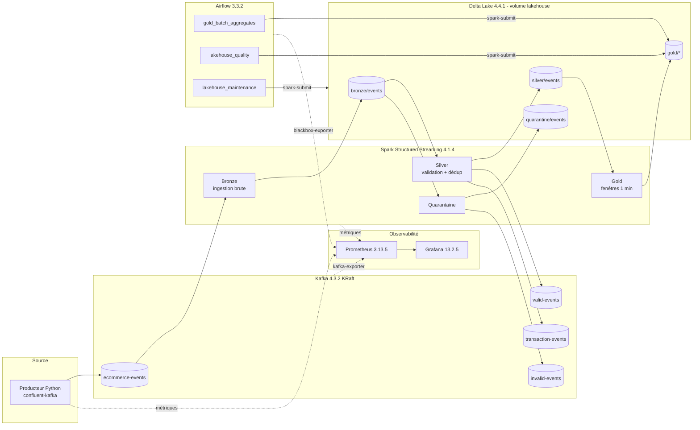
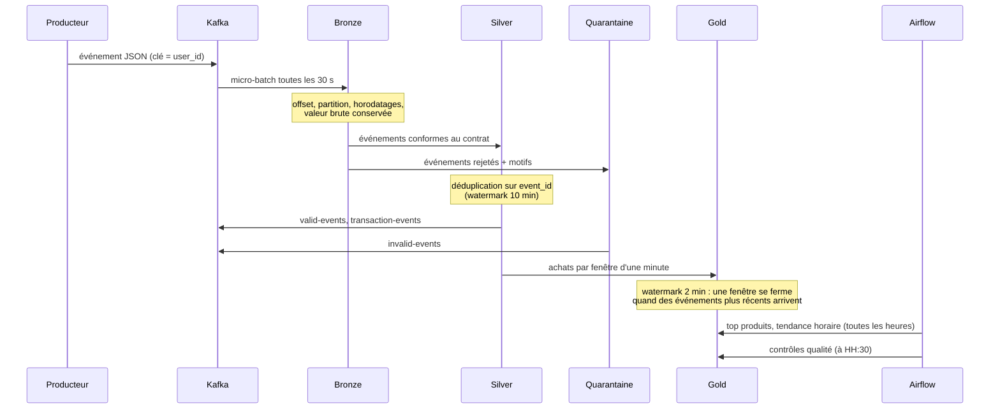

# Real-Time Analytics Pipeline


Pipeline de données e-commerce temps réel, de bout en bout et entièrement local :
des événements générés partent dans **Kafka**, sont traités par **Spark Structured
Streaming** dans une architecture **Medallion Delta Lake** (Bronze, Silver, Gold),
orchestrés par **Airflow** pour les traitements batch et la qualité, et supervisés par
**Prometheus** et **Grafana**. Toute la pile démarre avec **Docker Compose**, sans compte
cloud.

Le projet est vérifié par une réconciliation de bout en bout : avec une graine fixe, le
contenu attendu de chaque table est connu d'avance et comparé au contenu réel.

---

## Sommaire

1. [Objectifs](#1-objectifs)
2. [Fonctionnalités](#2-fonctionnalités)
3. [Architecture](#3-architecture)
4. [Flux de données](#4-flux-de-données)
5. [Stack technique](#5-stack-technique)
6. [Structure du dépôt](#6-structure-du-dépôt)
7. [Prérequis](#7-prérequis)
8. [Installation](#8-installation)
9. [Configuration](#9-configuration)
10. [Démarrage rapide](#10-démarrage-rapide)
11. [Générer des données](#11-générer-des-données)
12. [Contrat des événements](#12-contrat-des-événements)
13. [Couches Medallion](#13-couches-medallion)
14. [Qualité des données et garanties de livraison](#14-qualité-des-données-et-garanties-de-livraison)
15. [Orchestration Airflow](#15-orchestration-airflow)
16. [Monitoring et alertes](#16-monitoring-et-alertes)
17. [Interfaces web](#17-interfaces-web)
18. [Tests et vérification](#18-tests-et-vérification)
19. [Commandes utiles](#19-commandes-utiles)
20. [Choix techniques et compromis](#20-choix-techniques-et-compromis)
21. [Difficultés rencontrées](#21-difficultés-rencontrées)
22. [Dépannage](#22-dépannage)
23. [Limites connues](#23-limites-connues)
24. [Améliorations futures](#24-améliorations-futures)
25. [Captures d'écran à ajouter](#25-captures-décran-à-ajouter)
26. [Auteur](#26-auteur)

La procédure de démonstration pas à pas est dans [docs/DEMO.md](docs/DEMO.md).

---

## 1. Objectifs

- Montrer un pipeline de streaming complet, du producteur jusqu'aux indicateurs métier.
- Appliquer les pratiques d'un pipeline de production : contrat de données, quarantaine,
  déduplication, idempotence, contrôles qualité, métriques et alertes.
- Tourner sur un poste de développement ordinaire (16 Go de RAM, 4 cœurs), sans cloud.
- Ne rien affirmer sans preuve : les chiffres de ce README viennent d'exécutions réelles,
  datées dans la section [Tests et vérification](#18-tests-et-vérification).

## 2. Fonctionnalités

| Domaine | Ce qui est fait |
|---|---|
| Ingestion | Producteur Kafka idempotent (`acks=all`, compression lz4), débit réglable, mode borné ou continu |
| Données de test | Générateur reproductible avec une graine : événements valides, invalides, dupliqués et en retard, selon des ratios configurables |
| Bronze | Copie exacte des messages Kafka, exactement une fois (checkpoint + Delta) |
| Silver | Validation par le contrat JSON, motifs de rejet précis, quarantaine, déduplication sur `event_id` |
| Gold streaming | Ventes et activité par pays, par fenêtre d'une minute, avec watermark |
| Gold batch | Top produits du jour et tendance horaire des ventes, reconstruits par Airflow |
| Topics dérivés | `valid-events`, `invalid-events`, `transaction-events` republiés par Spark |
| Qualité | Contrôles par couche, historisés dans `gold/data_quality_results` |
| Maintenance | `OPTIMIZE` et `VACUUM` des tables Delta chaque nuit |
| Observabilité | 21 métriques métier et techniques, dashboard Grafana provisionné de 35 panneaux, 11 règles d'alerte |
| Exploitation | Scripts shell et Makefile : démarrer, générer, consulter l'état, tester, vérifier, arrêter |

## 3. Architecture



Les 5 requêtes de streaming (Bronze, Silver, quarantaine et les 2 tables Gold par minute)
tournent dans **une seule application Spark**, sur un cluster standalone d'un master et
d'un worker. Les jobs Airflow sont soumis au même cluster avec `spark-submit`.

Services Docker Compose :

| Service | Image | Rôle |
|---|---|---|
| `kafka` | `apache/kafka:4.3.2` | Broker unique en mode KRaft |
| `kafka-init` | `rtap-producer:local` | Crée les topics au démarrage |
| `producer` | `rtap-producer:local` | Producteur continu (profil `producer`, désactivé par défaut) |
| `spark-master`, `spark-worker` | `rtap-spark:local` | Cluster Spark standalone (worker : 4 cœurs, 2 Go) |
| `streaming` | `rtap-spark:local` | Application de streaming Medallion |
| `postgres` | `postgres:17-alpine` | Base de métadonnées d'Airflow |
| `airflow-init`, `airflow-apiserver`, `airflow-scheduler`, `airflow-dag-processor` | `rtap-airflow:local` | Airflow en LocalExecutor |
| `kafka-exporter` | `danielqsj/kafka-exporter:v1.11.0` | Métriques Kafka |
| `blackbox-exporter` | `prom/blackbox-exporter:v0.29.1` | Sondes de santé d'Airflow |
| `prometheus` | `prom/prometheus:v3.13.5` | Collecte des métriques et règles d'alerte |
| `grafana` | `grafana/grafana:13.2.5` | Dashboard provisionné |

## 4. Flux de données



## 5. Stack technique

| Composant | Version | Pourquoi |
|---|---|---|
| Python | 3.12 | Même version mineure dans les images Spark, Airflow et producteur |
| Java | 17 | Requis par Spark 4.1 |
| Apache Kafka | 4.3.2 (KRaft) | Plus de ZooKeeper : un seul conteneur |
| confluent-kafka | 2.16.1 | Client librdkafka, producteur idempotent |
| Apache Spark / PySpark | 4.1.4 | Structured Streaming, compatible Delta 4.4 |
| Delta Lake | 4.4.1 (`delta-spark_4.1_2.13`) | Transactions ACID, `txnAppId`/`txnVersion`, OPTIMIZE/VACUUM ; plafonne PySpark à < 4.2 |
| Apache Airflow | 3.3.2, provider Spark 6.3.2 | LocalExecutor, `SparkSubmitOperator` |
| PostgreSQL | 17 | Métadonnées Airflow |
| Prometheus | 3.13.5 | Métriques et règles d'alerte |
| Grafana | 13.2.5 | Dashboard provisionné depuis le dépôt |
| kafka-exporter / blackbox-exporter | 1.11.0 / 0.29.1 | Métriques Kafka et santé d'Airflow |
| Outils | pytest 9.2.0, pytest-cov 7.1.0, ruff 0.17.3, mypy 2.4.1, shellcheck | Tests, lint, typage |

Toutes les versions sont épinglées (`requirements/*.txt`, Dockerfiles, `docker-compose.yml`).

## 6. Structure du dépôt

```text
real-time-analytics-pipeline/
├── airflow/
│   ├── dags/                  # gold_batch_aggregates, lakehouse_quality, lakehouse_maintenance
│   └── plugins/rtap_airflow.py   # fabrique de tâches spark-submit, arguments par défaut
├── config/
│   ├── app.yaml               # configuration centrale, surchargée par l'environnement
│   ├── kafka/topics.yaml      # topics, partitions, rétention
│   └── spark/                 # spark-defaults.conf, metrics.properties, log4j2
├── dashboards/grafana/        # dashboard JSON + provisioning (datasource, dossier)
├── docker/                    # Dockerfiles spark, airflow, producer + installation des jars
├── docs/DEMO.md               # procédure de démonstration
├── jobs/                      # code Spark
│   ├── bronze/ingest.py
│   ├── silver/validation.py, transform.py
│   ├── gold/aggregations.py, streaming.py, batch_aggregates.py
│   ├── quality/checks.py
│   ├── maintenance/delta_maintenance.py
│   ├── metrics.py             # listener de requêtes -> métriques Prometheus
│   ├── session.py             # SparkSession, écriture Delta idempotente
│   └── streaming_pipeline.py  # point d'entrée de l'application de streaming
├── monitoring/
│   ├── prometheus/            # prometheus.yml, alerts.yml
│   └── blackbox/blackbox.yml
├── producers/                 # générateur d'événements, producteur Kafka, création des topics
├── schemas/event_schema.json  # contrat des événements (JSON Schema)
├── scripts/                   # scripts d'exploitation (bash)
├── src/rtap/                  # configuration et logs JSON partagés
├── tests/
│   ├── unit/                  # sur l'hôte, sans Docker
│   ├── integration/           # producteur contre un vrai Kafka
│   ├── spark/                 # Spark + Delta, dans l'image Spark
│   ├── dags/                  # structure des DAG, dans l'image Airflow
│   └── e2e/reconcile_pipeline.py  # réconciliation de bout en bout
├── .github/workflows/ci.yml
├── docker-compose.yml
├── Makefile
└── .env.example
```

## 7. Prérequis

| Élément | Minimum | Remarque |
|---|---|---|
| Docker Desktop (ou Docker Engine) + Compose v2 | Mémoire de la VM Docker ≥ 7 Go | Les scripts avertissent en dessous. Pile mesurée à environ 5,8 Go en charge |
| Machine | 16 Go de RAM, 4 cœurs | Configuration de développement |
| Shell | bash | Linux, macOS ou **Git Bash** sous Windows |
| Python sur l'hôte | 3.12 | Seulement pour les tests unitaires, le lint et mypy |
| `make` | facultatif | Chaque cible du Makefile correspond à un script `bash scripts/...` |
| Ports libres sur 127.0.0.1 | 8080, 8081, 4040, 9090, 9094, 3000 | Grafana se déplace avec `GRAFANA_HOST_PORT` |

Aucun compte cloud n'est nécessaire : le lakehouse est un volume Docker.

## 8. Installation

```bash
git clone <url-du-dépôt> real-time-analytics-pipeline
```
```bash
cd real-time-analytics-pipeline
```

Créer le fichier `.env` avec des secrets aléatoires (les valeurs déjà présentes sont
conservées, aucun secret n'est affiché) :

```bash
bash scripts/init_env.sh
```

Environnement Python de l'hôte, pour les tests unitaires et le lint (facultatif) :

```bash
python -m venv .venv
```
```bash
.venv/Scripts/python -m pip install -r requirements/dev.txt
```

Sous Linux ou macOS, remplacez `.venv/Scripts/python` par `.venv/bin/python`.
`requirements.txt` installe en plus PySpark et Delta sur l'hôte, ce qui n'est utile que
pour travailler sur les jobs Spark hors Docker.

## 9. Configuration

La configuration vit dans [config/app.yaml](config/app.yaml). Chaque valeur
`${VAR:-défaut}` peut être surchargée par `.env`. **Aucun secret n'est écrit dans le
code** : les mots de passe et clés sont dans `.env`, ignoré par Git, et
`docker-compose.yml` refuse de démarrer s'ils sont vides.

| Variable | Défaut | Rôle |
|---|---|---|
| `PRODUCER_EVENTS_PER_SECOND` | `50` | Débit du producteur continu |
| `PRODUCER_INVALID_RATIO` | `0.05` | Part d'événements invalides générés |
| `PRODUCER_DUPLICATE_RATIO` | `0.02` | Part de doublons |
| `PRODUCER_LATE_RATIO` | `0.03` | Part d'événements en retard (jusqu'à 180 s) |
| `STREAMING_TRIGGER_INTERVAL` | `30 seconds` | Intervalle des micro-batches |
| `KAFKA_HOST_PORT` | `9094` | Accès à Kafka depuis l'hôte |
| `GRAFANA_HOST_PORT` | `3000` | Port de Grafana sur l'hôte |
| `STORAGE_BACKEND` | `local` | `local`, `s3` ou `gcs` (voir [Limites](#23-limites-connues)) |
| `POSTGRES_PASSWORD`, `AIRFLOW_FERNET_KEY`, `AIRFLOW_JWT_SECRET`, `GRAFANA_ADMIN_PASSWORD` | requis | Générés par `scripts/init_env.sh` |

Seuils fixés dans `app.yaml` : 20 % maximum d'événements invalides, Gold vieux de
15 minutes au plus, rétention du `VACUUM` de 168 heures.

## 10. Démarrage rapide

```bash
bash scripts/start_pipeline.sh
```

Le script construit les images, démarre tous les services et attend qu'ils soient
sains. En local, avec les couches Docker déjà en cache, il a pris 254 s (200 s avec
`--no-build`). Le premier build, sans cache, est plus long et n'a pas été chronométré.

Envoyer des événements en continu (50 par seconde par défaut) :

```bash
bash scripts/generate_data.sh --continuous --rate 50
```

Voir l'état des services et les alertes actives :

```bash
bash scripts/status.sh
```

Ouvrir ensuite le dashboard Grafana : <http://localhost:3000> (identifiant
`GRAFANA_ADMIN_USER`, mot de passe dans `.env`).

Arrêter, en gardant les données :

```bash
bash scripts/stop_pipeline.sh
```

## 11. Générer des données

| Commande | Effet |
|---|---|
| `bash scripts/generate_data.sh --events 5000 --rate 100 --seed 42` | Envoie 5 000 événements reproductibles, puis s'arrête |
| `bash scripts/generate_data.sh --continuous --rate 50` | Producteur en arrière-plan |
| `bash scripts/generate_data.sh --stop` | Arrête le producteur en arrière-plan |

Le générateur tire les types d'événements selon des poids réalistes (beaucoup de vues,
moins d'achats), sur 8 catégories et 10 pays (France, Sénégal, Côte d'Ivoire, Mali,
Maroc, Belgique, Canada, Allemagne, Royaume-Uni, États-Unis). Le mobile money est plus
fréquent dans les pays où il est courant. Avec la même graine et les mêmes
ratios, il produit exactement la même suite de types d'événements (valide, invalide,
doublon, retard), quel que soit le moment de l'exécution : c'est ce qui permet la
réconciliation de bout en bout.

## 12. Contrat des événements

Le contrat est un JSON Schema : [schemas/event_schema.json](schemas/event_schema.json).
Spark lit ce même fichier pour valider les événements : contrat et validation ne
peuvent pas diverger.

| Champ | Type | Règle |
|---|---|---|
| `event_id` | string | UUID, clé de déduplication |
| `user_id`, `product_id` | string | `U` + 6 chiffres, `P` + 5 chiffres |
| `category` | enum | `electronics`, `fashion`, `home`, `beauty`, `sports`, `books`, `groceries`, `toys` |
| `amount` | number | ≥ 0, et > 0 pour une transaction |
| `quantity` | integer | Au moins 1 |
| `event_type` | enum | `page_view`, `add_to_cart`, `remove_from_cart`, `checkout`, `purchase`, `payment` |
| `timestamp` | string | Date ISO 8601, devient `event_ts` |
| `payment_method` | enum ou null | Obligatoire pour `purchase` et `payment` |
| `country` | string | Code pays ISO à 2 lettres majuscules |

Exemple de message :

```json
{
  "event_id": "8b0d2f9e-6f2c-4b8f-9a51-1f3c0f6b2a77",
  "user_id": "U001234",
  "product_id": "P00042",
  "category": "electronics",
  "amount": 249.9,
  "quantity": 1,
  "event_type": "purchase",
  "timestamp": "2026-11-03T22:25:14.254982+00:00",
  "payment_method": "card",
  "country": "FR"
}
```

Un événement refusé garde sa valeur brute et la liste de ses motifs, par exemple
`malformed_json`, `missing_payment_method`, `invalid_event_type`, `invalid_country` ou
`missing_<champ>`.

## 13. Couches Medallion

| Couche | Table Delta | Écrite par | Contenu |
|---|---|---|---|
| Bronze | `bronze/events` | streaming | Message Kafka brut, clé, partition, offset, horodatages Kafka et d'ingestion |
| Silver | `silver/events` | streaming | Événements valides, typés, dédupliqués |
| Quarantaine | `quarantine/events` | streaming | Événements rejetés, valeur brute et `rejection_reasons` |
| Gold | `gold/sales_per_minute` | streaming | Chiffre d'affaires, transactions, unités, panier moyen par minute |
| Gold | `gold/country_activity_per_minute` | streaming | Événements, utilisateurs actifs (approx.), transactions, CA par pays et par minute |
| Gold | `gold/top_products_daily` | Airflow | Classement des produits par chiffre d'affaires, pour chaque jour |
| Gold | `gold/sales_trend_hourly` | Airflow | Chiffre d'affaires par heure et écart avec l'heure précédente |
| Gold | `gold/data_quality_results` | Airflow | Historique des contrôles qualité |

Le chiffre d'affaires ne compte que les événements `purchase`, pour ne pas compter deux
fois un achat et son paiement.

## 14. Qualité des données et garanties de livraison

| Étape | Garantie | Mécanisme |
|---|---|---|
| Producteur → Kafka | Pas de doublon causé par les retries | `enable.idempotence=true`, `acks=all` |
| Kafka → Bronze | Exactement une fois | Checkpoint Spark + commit Delta transactionnel |
| Bronze → Silver / quarantaine | Exactement une fois | `foreachBatch` avec `txnAppId`/`txnVersion` : un micro-batch rejoué n'est pas réécrit |
| Doublons métier | Supprimés en Silver | Déduplication sur `event_id`, watermark de 10 minutes |
| Silver → topics Kafka dérivés | Au moins une fois | Un micro-batch rejoué après un crash peut republier des messages |
| Silver → Gold par minute | Exactement une fois par fenêtre fermée | Watermark de 2 minutes, mode `append` |

Un événement qui arrive plus de 2 minutes après sa fenêtre est bien dans Silver, mais
plus dans les agrégats Gold par minute. Les tables batch, reconstruites depuis Silver,
l'incluent.

Contrôles du DAG `lakehouse_quality` :

| Couche | Contrôles |
|---|---|
| Bronze | Table non vide, offsets Kafka uniques, horodatage d'ingestion présent |
| Silver | Non vide, `event_id` uniques, aucune valeur manquante, montants et quantités valides, transactions complètes, taux de rejet ≤ 20 %, rien d'inconnu de Bronze |
| Gold | Non vide, données de moins de 15 minutes, fenêtres uniques, CA non négatif, panier moyen cohérent |

## 15. Orchestration Airflow

| DAG | Planification | Tâches |
|---|---|---|
| `gold_batch_aggregates` | toutes les heures | `validate_silver` → `build_gold_tables` |
| `lakehouse_quality` | à HH:30 | `check_bronze` → `check_silver` → `check_gold` |
| `lakehouse_maintenance` | chaque jour à 02:00 | `optimize_tables` → `vacuum_tables` → `verify_tables` |

Chaque tâche est un `SparkSubmitOperator` créé par
[airflow/plugins/rtap_airflow.py](airflow/plugins/rtap_airflow.py), avec 2 relances
(aucune pour `validate_silver`) et journalisation des échecs. Les jobs passent par un pool `spark_jobs` d'un seul slot : un
seul job batch à la fois partage le cluster avec le streaming, ce qui protège la mémoire.

Déclencher un DAG à la main :

```bash
docker compose exec airflow-scheduler airflow dags trigger lakehouse_quality
```

## 16. Monitoring et alertes

**Cibles Prometheus** : producteur (`:8000`), application de streaming (`:8001`), master
et worker Spark, Kafka (via kafka-exporter), Airflow (via blackbox-exporter : santé du
scheduler, de la base de métadonnées et du dag-processor), Prometheus et
blackbox-exporter eux-mêmes.

**Métriques exposées par le projet** (préfixe `rtap_`) :

| Famille | Métriques |
|---|---|
| Producteur | `producer_events_sent`, `producer_events_delivered`, `producer_delivery_failures`, `producer_buffer_full`, `producer_delivery_latency_seconds`, `producer_target_events_per_second` |
| Streaming | `streaming_input_rows`, `streaming_input_rows_per_second`, `streaming_processed_rows_per_second`, `streaming_batch_duration_seconds`, `streaming_state_rows`, `streaming_rows_dropped_by_watermark`, `streaming_duplicates_dropped`, `streaming_query_failures`, `streaming_active_queries` |
| Métier | `pipeline_events_valid`, `pipeline_events_rejected`, `pipeline_events_quarantined`, `pipeline_transactions`, `pipeline_revenue_euros`, `pipeline_latency_seconds` |

Ces métriques sont calculées à partir des données réellement traitées. Aucune valeur du
dashboard n'est simulée. Les panneaux fondés sur `increase()` sont des estimations
Prometheus, et leur description le précise.

**Dashboard** « Real-Time Analytics Pipeline », dans le dossier du même nom, provisionné depuis
[dashboards/grafana/dashboards/pipeline-overview.json](dashboards/grafana/dashboards/pipeline-overview.json),
35 panneaux répartis en 7 rangées : Overview, Throughput, Latency (Kafka → Silver,
micro-batches, accusés du producteur), Data quality (rejets par motif, doublons et
retards écartés), Business, Services, Error history (avec les alertes actives).

**Règles d'alerte** ([monitoring/prometheus/alerts.yml](monitoring/prometheus/alerts.yml)) :

| Alerte | Condition | Délai | Sévérité |
|---|---|---|---|
| `ServiceDown` | Une cible hors producteur et Airflow ne répond plus | 1 min | critical |
| `ProducerDown` | Producteur injoignable | 5 min | warning |
| `AirflowComponentUnhealthy` | Une sonde Airflow échoue | 2 min | critical |
| `SparkNoAliveWorker` | Aucun worker Spark vivant | 1 min | critical |
| `SparkApplicationsWaiting` | Applications Spark en attente de ressources | 5 min | warning |
| `StreamingQueryMissing` | Moins de 5 requêtes de streaming actives | 2 min | critical |
| `StreamingQueryFailed` | Une requête a échoué dans les 15 dernières minutes | dès la détection | critical |
| `StreamingStalled` | Bronze ne lit plus rien alors que le producteur livre | 5 min | critical |
| `HighPipelineLatency` | Latence p95 > 120 s | 5 min | warning |
| `ProducerDeliveryFailures` | Échecs de livraison Kafka sur 5 minutes | dès la détection | warning |
| `HighRejectionRatio` | Plus de 10 % d'événements rejetés | 10 min | warning |

Les alertes sont visibles dans Prometheus (<http://localhost:9090/alerts>), dans le
dashboard, et avec `bash scripts/status.sh`. Aucun canal de notification externe n'est
configuré (voir [Améliorations futures](#24-améliorations-futures)).

## 17. Interfaces web

Tous les ports sont liés à `127.0.0.1` : rien n'est exposé sur le réseau.

| Interface | URL | Accès |
|---|---|---|
| Grafana | <http://localhost:3000> | `GRAFANA_ADMIN_USER` / `GRAFANA_ADMIN_PASSWORD` du `.env` |
| Airflow | <http://localhost:8080> | Sans connexion : simple auth manager, tout le monde est admin, pour un usage local uniquement |
| Prometheus | <http://localhost:9090> | Libre |
| Spark master | <http://localhost:8081> | Libre |
| Application de streaming (Spark UI) | <http://localhost:4040> | Libre |
| Kafka (depuis l'hôte) | `localhost:9094` | Listener externe |

## 18. Tests et vérification

| Suite | Commande | Où | Résultat mesuré |
|---|---|---|---|
| Unitaires | `bash scripts/run_tests.sh unit` | hôte | 67 réussis, couverture 81 % (`rtap`, `producers`) |
| Spark + Delta | `bash scripts/run_tests.sh spark` | image Spark | 71 réussis en 245 s, couverture 58 % de `jobs` |
| DAG Airflow | `bash scripts/run_tests.sh dags` | image Airflow | 7 réussis |
| Typage | `bash scripts/run_tests.sh typecheck` | hôte + image Spark | mypy : 0 erreur (7 + 21 fichiers) |
| Intégration | `bash scripts/run_tests.sh integration` | hôte + Kafka démarré | non relancée lors de la dernière campagne |
| Bout en bout | `bash scripts/verify_pipeline.sh` | pile démarrée et vide | réussie, voir ci-dessous |
| Lint | `ruff check .`, `ruff format --check .`, `shellcheck -x scripts/*.sh` | hôte | aucune remarque |

Les points d'entrée (`streaming_pipeline.py`, `batch_aggregates.py`) ne sont pas
couverts par les tests unitaires. Ils sont exercés par la vérification de bout en bout,
qui ne mesure pas la couverture.

**Vérification de bout en bout** ([scripts/verify_pipeline.sh](scripts/verify_pipeline.sh)) :

1. attend qu'Airflow ait fini ses exécutions de rattrapage du démarrage ;
2. envoie 24 000 événements avec la graine 42 ;
3. attend que Bronze, Silver et la quarantaine les aient lus ;
4. réconcilie les tables avec le rejeu du générateur et les offsets Kafka ;
5. exécute les deux DAG pendant qu'un producteur continu tourne, puis contrôle leurs
   sorties ;
6. vérifie que Prometheus collecte toutes les cibles et qu'aucune alerte critique n'est
   active.

Résultat de la dernière exécution, le 3 novembre 2026 sur pile vierge (Windows 11,
Docker Desktop, VM de 7,8 Go) :

| Contrôle | Observé | Attendu |
|---|---|---|
| Événements reçus par Kafka | 24 000 | 24 000 |
| Lignes Bronze / offsets distincts | 24 000 / 24 000 | = Kafka |
| Lignes Silver (`event_id` uniques) | 22 373 | 22 373 (valides + en retard) |
| Lignes en quarantaine | 1 176 | 1 176 (invalides) |
| Bronze = Silver + quarantaine + doublons | 24 000 | 24 000 |
| Fenêtres Gold fermées | 4, sans doublon | > 0 |
| Transactions Gold / Silver (fenêtres fermées) | 941 / 941 | écart ≤ achats en retard (39) |
| Chiffre d'affaires Gold / Silver | 424 282,37 / 424 282,37 | Gold ≤ Silver |
| DAG `gold_batch_aggregates`, `lakehouse_quality` | réussis (6 min chacun) | réussis |
| Contrôles qualité, dernier de chaque couche | aucun échec | aucun échec |
| Cibles Prometheus | 9 sur 9 actives | toutes |
| Alertes critiques | 0 | 0 |

Durée totale : 52 min, dont environ 5 min de démarrage de la pile et 23 min d'attente du
rattrapage d'Airflow. Pression mémoire maximale (PSI « full », moyenne sur 10 s) :
3,2 %.

**Intégration continue** : [.github/workflows/ci.yml](.github/workflows/ci.yml) lance le
lint, mypy, les tests unitaires, shellcheck, la validation de la configuration Compose,
Prometheus et blackbox, puis les tests Spark et les tests des DAG. Le workflow est validé
par actionlint mais **n'a encore jamais tourné sur GitHub**.

## 19. Commandes utiles

| Make | Script équivalent | Effet |
|---|---|---|
| `make env` | `bash scripts/init_env.sh` | Crée `.env` avec des secrets aléatoires |
| `make build` | `docker compose --profile producer build` | Construit les images |
| `make start` | `bash scripts/start_pipeline.sh` | Démarre la pile (sans producteur) |
| `make start-all` | `bash scripts/start_pipeline.sh --with-producer` | Démarre avec le producteur continu |
| `make topics` | `bash scripts/create_topics.sh` | Crée et liste les topics |
| `make generate EVENTS=10000 RATE=100` | `bash scripts/generate_data.sh --events 10000 --rate 100` | Lot d'événements |
| `make produce RATE=50` | `bash scripts/generate_data.sh --continuous --rate 50` | Producteur en arrière-plan |
| `make produce-stop` | `bash scripts/generate_data.sh --stop` | Arrête le producteur |
| `make status` | `bash scripts/status.sh` | Services et alertes actives |
| `make logs SERVICE=streaming` | `docker compose --profile producer logs -f --tail 100 streaming` | Suit les logs |
| `make test` | `bash scripts/run_tests.sh all` | Unitaires, Spark, DAG, typage |
| `make verify` | `bash scripts/verify_pipeline.sh` | Vérification de bout en bout |
| `make lint` | `python -m ruff check . && python -m ruff format --check .` | Lint Python |
| `make stop` | `bash scripts/stop_pipeline.sh` | Arrête, garde les données |
| `make clean` | `bash scripts/stop_pipeline.sh --volumes` | Arrête et supprime les volumes (demande confirmation) |

## 20. Choix techniques et compromis

| Choix | Bénéfice | Contrepartie |
|---|---|---|
| Un seul broker Kafka, réplication 1 | Tient sur un portable | Pas de tolérance à la panne du broker |
| Une seule application Spark pour toutes les requêtes | Une seule JVM driver : moins de mémoire | Si une requête échoue, l'application redémarre entière (depuis ses checkpoints) |
| Cluster Spark standalone (1 master, 1 worker) | Proche d'un vrai cluster, UI et métriques du master | Moins simple qu'un `local[*]` |
| Delta Lake sur un volume Docker | Aucun compte cloud, transactions ACID | Pas de stockage objet réel par défaut |
| Validation par le contrat JSON partagé | Producteur et Spark ne divergent pas | Le contrat doit rester exprimable en règles Spark |
| Quarantaine plutôt que rejet silencieux | Chaque rejet est explicable et rejouable | Une table et un topic de plus |
| Topics dérivés au moins une fois | Simple, sans transactions Kafka | Doublons possibles en aval après crash |
| Gold en `append` avec watermark | Agrégats définitifs, jamais réécrits | Une fenêtre ne se ferme que si de nouveaux événements arrivent |
| Airflow en LocalExecutor | Pas de Redis ni de Celery | Pas de mise à l'échelle horizontale |
| Pool Airflow d'un slot pour Spark | Protège la mémoire du poste | Les jobs batch passent les uns après les autres |
| Ports liés à `127.0.0.1`, Airflow sans connexion | Démonstration simple | Non adapté à un serveur partagé |

## 21. Difficultés rencontrées

- **Blocages de la machine pendant les tests longs.** La mesure de pression mémoire de la
  VM Docker (`/proc/pressure/memory`) a montré une famine mémoire (swap plein, PSI
  « full » à 49 %), et non une mise en veille. Les tailles de heap Spark ont été
  réduites service par service. Un worker limité à 2,5 Go était tué par l'OOM killer :
  3 Go ont été retenus.
- **Worker Spark oublié après un gel de la VM.** Le master refusait la reconnexion d'un
  worker considéré comme mort. Corrigé avec `spark.dead.worker.persistence`, puis
  vérifié par un `docker pause` de 17 minutes.
- **Faux doublon apparent dans Bronze après un redémarrage.** Prometheus renvoie le
  dernier échantillon pendant 5 minutes quand il s'arrête en même temps que ses cibles.
  La table Delta, vérifiée offset par offset, était correcte.
- **Contrôle de fraîcheur Gold en échec lors d'une exécution bornée.** Le comportement
  était correct : une fenêtre ne se ferme qu'à l'arrivée d'événements plus récents. La
  vérification exécute donc les DAG sur un flux vivant, comme en exploitation.
- **Rattrapage d'Airflow au démarrage.** Avec `catchup=False`, Airflow lance quand même
  le dernier intervalle de chaque DAG, ce qui occupe le pool et la mémoire. La
  vérification attend désormais qu'Airflow soit inactif.
- **Grafana ne démarrait pas avec 256 Mo** (ramasse-miettes saturé) : limite portée à
  512 Mo, avec 240 s de délai de démarrage.
- **Git Bash sous Windows** convertit les chemins `/opt/...` : les scripts exportent
  `MSYS_NO_PATHCONV=1` et montent les volumes avec `pwd -W`.

## 22. Dépannage

| Symptôme | Cause probable | Action |
|---|---|---|
| `Set POSTGRES_PASSWORD in .env` au démarrage | `.env` absent ou incomplet | `bash scripts/init_env.sh` |
| Port 3000 déjà utilisé | Autre application sur l'hôte | `GRAFANA_HOST_PORT=3001` dans `.env` |
| Avertissement de mémoire Docker au démarrage | VM Docker < 7 Go | Augmenter la mémoire dans Docker Desktop |
| Machine qui gèle, `Heartbeat recovered` dans les logs Airflow | Famine mémoire | Fermer les autres conteneurs, ne pas lancer de job Spark local en parallèle |
| Gold reste vide | Aucune fenêtre fermée : il faut des événements plus récents que la fenêtre + 2 min | Laisser tourner le producteur quelques minutes |
| `check_gold` échoue sur `fresh_data` | Producteur arrêté depuis plus de 15 min | Comportement attendu : relancer le producteur |
| `verify_pipeline.sh` refuse de démarrer | Kafka contient déjà des événements | `bash scripts/stop_pipeline.sh --volumes --yes`, puis `bash scripts/start_pipeline.sh` |
| Message `Coordinator load in progress` au premier envoi | Le broker vient de démarrer | Sans conséquence : le producteur réessaie |

## 23. Limites connues

- **S3 et GCS ne sont pas testés.** Le code gère `STORAGE_BACKEND=s3|gcs` et
  l'installation des connecteurs (`INSTALL_CLOUD_CONNECTORS=true`), mais aucune
  exécution n'a eu lieu sur un vrai bucket.
- La CI n'a jamais tourné sur GitHub, et les scripts n'ont été exécutés que sous
  Windows 11 avec Git Bash, pas sous Linux ni macOS.
- Kafka a un seul broker, avec une réplication de 1.
- Les topics dérivés sont en « au moins une fois ».
- Airflow n'a pas d'authentification : usage local uniquement.
- Le rendu du dashboard a été vérifié par l'API de Grafana (34 requêtes, 0 erreur),
  pas par une revue visuelle complète.
- La marge mémoire est faible sur une VM Docker de 8 Go.

## 24. Améliorations futures

- Exécuter la CI sur GitHub et publier les badges réels de build et de couverture.
- Tester S3 avec MinIO dans Compose, puis un vrai bucket.
- Rendre les topics dérivés exactement une fois (producteur transactionnel ou
  déduplication côté consommateur).
- Ajouter un Schema Registry (Avro ou Protobuf) avec gestion de l'évolution du schéma.
- Envoyer les alertes vers un canal (Alertmanager vers e-mail ou Slack).
- Passer à 3 brokers Kafka et à un cluster Spark sur Kubernetes pour un environnement
  partagé.
- Ajouter une couche de consultation (Trino ou DuckDB) et un tableau de bord métier.
- Contrôles qualité déclaratifs (Great Expectations ou Soda) et lignage (OpenLineage).

## 25. Captures d'écran à ajouter

Aucune capture n'est encore dans le dépôt. Pour en ajouter, enregistrez-les dans
`docs/images/` sous ces noms, puis insérez-les dans les sections indiquées :

| Fichier | Contenu | Section |
|---|---|---|
| `docs/images/grafana-overview.png` | Dashboard Grafana, rangées Overview et Throughput, producteur actif | 16 |
| `docs/images/grafana-quality.png` | Rangées Data quality et Business | 16 |
| `docs/images/airflow-dags.png` | Liste des 3 DAG dans Airflow, derniers runs réussis | 15 |
| `docs/images/airflow-quality-run.png` | Vue graphe de `lakehouse_quality` | 15 |
| `docs/images/spark-streaming.png` | Onglet Structured Streaming de la Spark UI (port 4040) | 13 |
| `docs/images/prometheus-alerts.png` | Page des alertes Prometheus pendant le test de panne du worker | 16 |
| `docs/images/verify-output.png` | Sortie de `bash scripts/verify_pipeline.sh` | 18 |

La [procédure de démonstration](docs/DEMO.md) indique à quel moment prendre chaque
capture.

## 26. Auteur

**Daouda Bamba** : conception, développement et vérification du projet.
